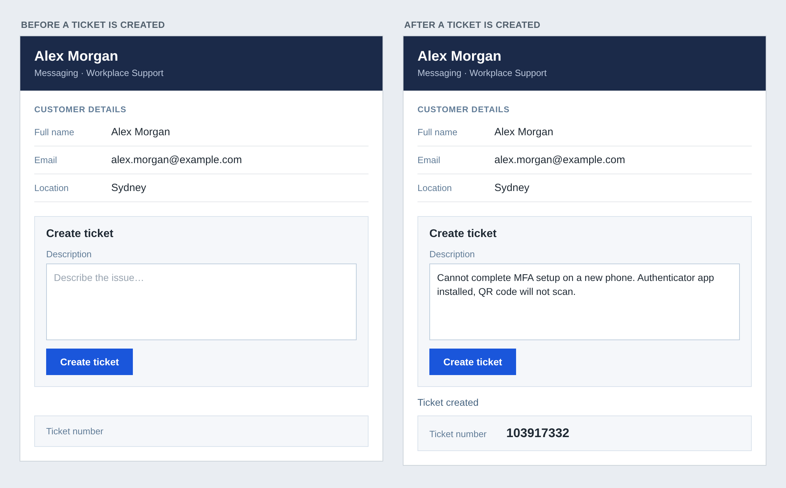

# Script panel redesign

`Chat Ticket Panel.script` is an agent script you can import into Genesys Cloud. It carries the
new design and the script's variables. It does **not** carry the steps inside the Create Ticket
action; you add those by hand after importing (see below).



The mockup is a drawing of the target, not a screenshot from Genesys.

## Read this first

- **It imports as a new script.** Your current script is not touched and stays live until you
  switch over.
- **It has not been imported into a live org.** The file's structure was checked against a
  sample script export published by Genesys and against the Script Editor's own source code.
  Your first import is the real test.
- **The Create Ticket action is empty.** Its three steps point at data actions by ID, and those
  IDs and some of the step settings could not be read from photos.

## Import

1. Admin > Contact Center > **Scripts** > **Import**, and choose `Chat Ticket Panel.script`.
2. Open the new script **Chat Ticket Panel**. It has one page, **Chat Page**, with the design
   in the mockup.

## Finish the back end

Open your current script in a second browser tab and copy the settings across.

### 1. Create Ticket action

In the new script open the custom action **Create Ticket** (the button already calls it) and
add the same steps your current script has:

| # | Step | Notes |
|---|---|---|
| 1 | Data Actions.Execute Data Action — **Create Ticket (v8)** | Same inputs and outputs as today. |
| 2 | **Wait Until** `ticketReturnCode` Equals `0` | Inside it: Execute Data Action — **Insert Data Table Row (Chat Logs)**. |
| 3 | Data Actions.Execute Data Action — **Set Conversation Ticket Number** | `conversationId` = `{{Scripter.Interaction ID}}`, `participantId` = `{{Scripter.Customer Participant ID}}`, `ticketNumber` = `{{InteractionId}}`. |

### 2. Variables

The file creates these. Check each against your current script and correct anything that
differs; only `InteractionId` was visible in full.

| Variable | Type | Input | Output | Default |
|---|---|---|---|---|
| `assetId` | String | on | off | empty |
| `email` | String | on | off | empty |
| `fullname` | String | on | off | empty |
| `InteractionId` | String | on | on | empty |
| `location` | String | on | off | empty |
| `ticketDescription` | String | off | off | empty |
| `ticketReturnCode` | Number | off | off | `0` |
| `ticketStatus` | String | off | off | empty |

- **`ticketReturnCode` default:** step 2 waits for this to equal `0`. If your current script
  uses a different default, set the same one here, otherwise the wait ends immediately.
- **The dynamic True/False variable** (its name starts `ticketCreati…`) is not in the file,
  because its full name and formula were not visible. Add it if anything on the page needs it.

### 3. Switch over

1. Publish the new script.
2. Point whatever opens the script today at the new one: the **Set Screen Pop** action in the
   message flow, or the queue's default script. Re-map the script inputs (`fullname`, `email`,
   `location`, `assetId`, `InteractionId`).
3. Run a test chat: create a ticket and confirm the ticket number shows and the AI summary
   still lands on the ticket.

## What the design uses

| Part | Settings |
|---|---|
| Header band | Background `#1B2A49`. Name 15 pt bold white. Second line 10 pt `#B8C4D9`. |
| Customer details | Title 9 pt bold `#627D98`. Label 10 pt `#627D98`, 110 px wide. Value 11 pt `#1F2933`. Each row has a 1 px bottom border `#E4E7EB`. |
| Create ticket card | Background `#F5F7FA`, 1 px border `#D9E2EC`, padding 16. Heading 12 pt bold. Multi-line input 120 px high, labelled "Description". |
| Button | Background `#1A56DB`, white bold 10 pt text, 130 × 36 px. |
| Status line | `{{ticketStatus}}`, 10 pt `#486581`. |
| Ticket number box | Background `#F5F7FA`, 1 px border `#D9E2EC`. Number 14 pt bold. |

Font sizes in the Script Editor are in points.

## Changing the design

The file is generated by `tools/script-generator/generate.js` (Node.js, no dependencies):

```bash
node tools/script-generator/generate.js
```

Colours, sizes and layout are near the bottom of that file.
